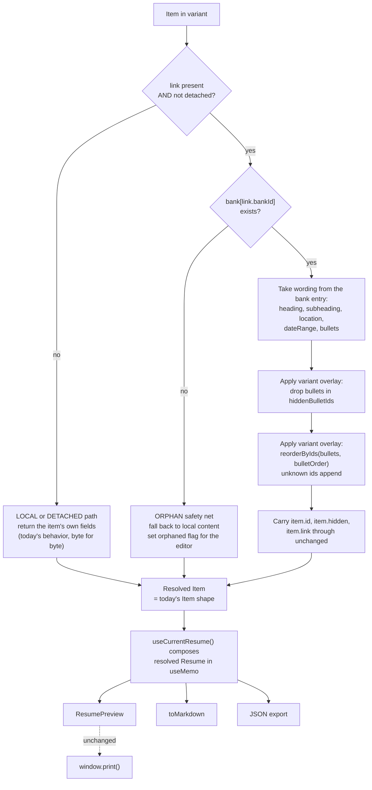
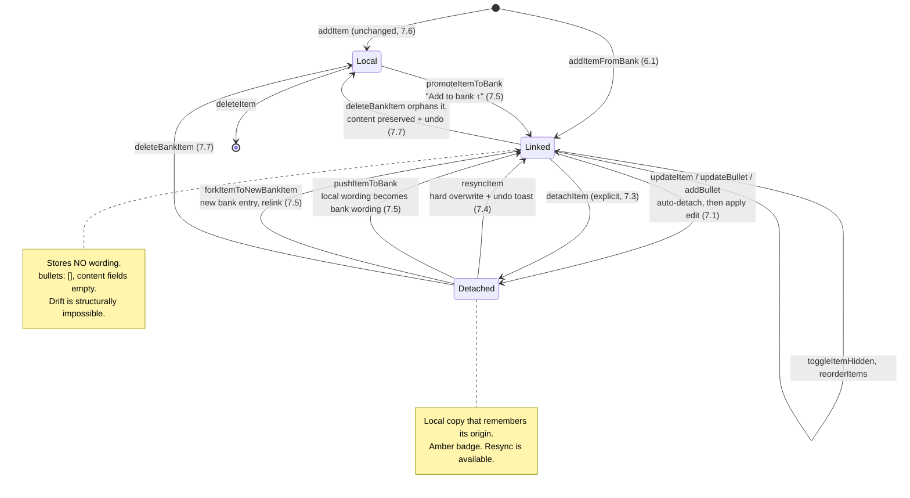

# Design: Item Bank and Editor UX

## 1. Problem statement

Today every variant owns a private, deep copy of its content. `duplicateVariant` runs
`cloneSection`, which regenerates every item and bullet id, so the moment a variant is created it
has no relationship to its source. Fixing a typo in a job description means finding that job in
every variant and retyping it. The user applies to many roles and keeps a growing set of variants,
so the cost of a single wording fix scales linearly with the number of variants and the error mode
is silent: an old phrasing ships in a PDF because one variant was missed.

Four smaller problems compound it:

- **The preview clips on narrow screens.** `.page` is a hard `width: 8.5in` and `.pane-preview` is
  `flex: 0 0 auto`, so below roughly 1500px the right edge of the resume is simply cut off. There is
  no zoom and no horizontal scroll on the preview.
- **Pane widths are fixed.** `.pane-sidebar` is `flex: 0 0 240px`, `.pane-editor` is
  `flex: 1 1 420px`. Panes can be reordered and minimized but not resized, so the only way to give
  the preview room is to minimize the editor entirely.
- **Collapse is one level deep.** `uiStore.collapsedSections` collapses a whole section; individual
  items cannot be collapsed and there is no collapse-all. A long resume is a long scroll.
- **Nothing reports whether the resume still fits on one page.** The user finds out at
  `Cmd+P`, after the trim-to-fit editing loop is already over.

This design adds a shared **bank** of items that variants compose from, and fixes the four UX gaps.

## 2. Locked requirements

Settled in prior discussion. These are constraints, not proposals. Numbering here is authoritative:
`tasks.md` and the correctness properties below reference it.

### Requirement 1 — Resizable panes

1.1 WHEN the user drags a divider between two adjacent non-minimized panes THEN the system SHALL set the left pane's width in pixels and reflow live.
1.2 WHEN the user double-clicks a divider THEN the system SHALL clear that explicit width and return the pane to auto/flex sizing.
1.3 WHEN a drag would take the Editor pane below 420px THEN the system SHALL clamp at 420px.
1.4 WHEN the page reloads THEN pane widths SHALL reset. Unpersisted by design, matching the documented pane-layout invariant.
1.5 THE divider hit target SHALL be spatially distinct from the `⠿` pane reorder handle so resize and reorder gestures do not fight.
1.6 WHEN printing THEN dividers SHALL NOT appear in the output.

### Requirement 2 — Preview auto-fit and zoom

2.1 WHEN the preview pane is narrower than the page THEN the system SHALL scale the page down so its full 8.5in width is visible.
2.2 THE zoom control SHALL offer Fit/50/75/100 with Fit as the default, and Fit SHALL never scale above 1.
2.3 WHEN the applied scale makes the page exceed the pane in either axis THEN the pane SHALL scroll on both axes.
2.4 THE scaled wrapper's height SHALL equal the page's laid-out height times the scale so the vertical scroll extent stays correct.
2.5 WHEN printing THEN the transform SHALL be `none` and the wrapper SHALL NOT affect output.
2.6 THE active scale factor SHALL be exposed from one place so every consumer agrees on it.

### Requirement 3 — Two-level collapse

3.1 WHEN the user clicks an item's chevron THEN the system SHALL hide that item's field grid and bullet list while keeping its toolbar and heading line visible.
3.2 WHEN the user clicks Collapse all THEN every section AND every item SHALL collapse in one action.
3.3 WHEN the user clicks Expand all THEN every section and item SHALL expand.
3.4 Collapse state SHALL be UI-only: never persisted, never exported, never present in the resume JSON.
3.5 Collapsing SHALL NOT change the preview or the printed output.

### Requirement 4 — Page-fit indicator

4.1 THE system SHALL compare measured page content height against the 10in (960px) printable box and report fits or over-by.
4.2 WHEN content fits THEN the badge SHALL report the remaining space in inches.
4.3 WHEN content overflows THEN the badge SHALL report the overflow in inches and a dashed rule SHALL mark the estimated break point.
4.4 THE overlay SHALL be a sibling of `.page`, never a child, so it cannot affect layout or leak into extracted text.
4.5 THE UI SHALL state that the estimate is approximate to within about one line.
4.6 WHEN printing THEN the overlay SHALL be hidden.
4.7 `.r-item` SHALL carry `break-inside: avoid` plus `orphans`/`widows` so a real print break does not split an item's bullets.
4.8 THE height source SHALL sit behind one function so a future exact-pagination check is a localized change.

### Requirement 5 — Bank data model

5.1 THE library SHALL hold a top-level `bank` array of bank items, each tagged with a section kind.
5.2 THE bank SHALL be the source of truth for the wording of every item linked to it.
5.3 A variant item SHALL be exactly one of **linked**, **detached**, or **local**.
5.4 A linked item SHALL store no wording of its own: empty content fields and `bullets: []`.
5.5 THE bank SHALL start empty. No auto-migration, no content-hash auto-linking.
5.6 `schemaVersion` SHALL become 3 with a v2→v3 migration in BOTH `parseImport` and the zustand `migrate`, passing every existing variant through unchanged and setting `bank: []`.
5.7 `link` SHALL be declared on `ItemSchema` so zod does not strip it on import.

### Requirement 6 — Resolution

6.1 WHEN an item is linked and not detached THEN reads SHALL take wording from the bank entry, then apply the variant's `hidden`, `hiddenBulletIds`, and `bulletOrder` on top.
6.2 WHEN an item is detached or local THEN reads SHALL return the item's own fields, i.e. today's behavior exactly.
6.3 WHEN a linked item's bank entry is missing THEN resolution SHALL fall back to the item's local content and flag it in the editor, never throw.
6.4 `link` SHALL survive resolution so the editor renders badges without a second lookup.
6.5 THE resolved shape SHALL be identical to today's `Resume`, so `ResumePreview`, `toMarkdown`, and JSON export need no changes.
6.6 `useCurrentResume()` SHALL select variant and bank separately and compose in `useMemo` so its return value is referentially stable across unrelated renders.
6.7 THE editor SHALL be able to read the raw unresolved item alongside the resolved one.

### Requirement 7 — Link lifecycle

7.1 WHEN the user edits wording or adds a bullet on a linked item THEN the system SHALL auto-detach first, then apply the edit locally.
7.2 WHEN the user hides or reorders bullets on a linked item THEN the item SHALL remain linked.
7.3 WHEN the user detaches an item THEN the system SHALL resolve it once, write the resolved content locally, bake the visibility overlay into the local bullets, clear the overlay fields, and set `detached: true`.
7.4 WHEN the user resyncs a detached item THEN the system SHALL hard-overwrite from the bank by clearing local content and dropping the flag, with an undo toast. No three-way merge, no base snapshots, no per-field dirty tracking.
7.5 THE system SHALL support push-local-to-bank, add-to-bank (promote a local item), and fork-as-new-bank-item.
7.6 Creating a purely local item SHALL keep working exactly as today. Sections SHALL NOT depend only on the bank.
7.7 WHEN a bank item is deleted THEN referencing variant items SHALL be orphaned into local items with content intact plus an undo toast. The delete SHALL NEVER be blocked by a reference count.
7.8 Linked items SHALL show a green dot, detached amber, local no badge.

### Requirement 8 — Variant-local visibility and order

8.1 WHEN `toggleBulletHidden` targets a linked item THEN it SHALL write `hiddenBulletIds` rather than mutate `bullets`.
8.2 WHEN `reorderBullets` targets a linked item THEN it SHALL write `bulletOrder` rather than mutate `bullets`.
8.3 WHEN a bank item gains a bullet THEN that bullet SHALL append in every linked variant rather than vanish.
8.4 Visibility and order changes in one variant SHALL NOT affect another variant linked to the same bank item.

### Requirement 9 — Bank UI

9.1 Bank CRUD SHALL live in the Variants pane behind a `Variants ⇄ Bank` dropdown with a section-kind switcher inside, and SHALL NOT add chrome to the editor or preview panes.
9.2 THE bank panel SHALL support add, update, delete, duplicate, label-rename, and bullet add/update/delete/reorder.
9.3 `SectionEditor` SHALL offer a "+ From bank" picker listing bank entries of that section's kind, marking those already used in the active variant.
9.4 A bank item's list label SHALL default to its heading when no explicit label is set.

### Requirement 10 — Export and import

10.1 Single-variant export SHALL inline fully resolved content while carrying `link`, `hiddenBulletIds`, and `bulletOrder` as inert metadata, so the file stays readable to Claude.ai and a re-import can tell a tailored copy from an untouched one.
10.2 Library/backup export SHALL include `bank`.
10.3 WHEN importing, for each item carrying a `link` THEN the system SHALL compare inlined content against the bank entry: identical → stay linked and drop the duplicated wording; different → set `detached: true` and keep the imported copy.
10.4 WHEN items diverged THEN the system SHALL surface a review summary, e.g. "7 items diverged from the bank — review".
10.5 Import SHALL still accept v2 files and files carrying no `link` metadata.

### Requirement 11 — Bank bootstrap

11.1 THE empty bank SHALL present a guided importer: pick source variant → pick sections → preview what gets created → confirm.
11.2 THE importer SHALL skip already-linked items and support running on a subset of sections.
11.3 Per-item "Add to bank ↑" SHALL remain available as the primary incremental path.

### Requirement 12 — Prompt and docs

12.1 PROMPTS.md SHALL state: preserve every `id` verbatim; omit via `hidden: true` not deletion; reorder by moving array elements; rewording allowed, inventing experience not; leave `link`, `hiddenBulletIds`, and `bulletOrder` metadata untouched; return the complete JSON document, not a diff or fragment.
12.2 A "Copy tailoring prompt" button SHALL put the rules plus the active variant's exported JSON on the clipboard.
12.3 CLAUDE.md and ONBOARDING.md SHALL document the bank architecture, the three link states, resolve-on-read, the memoization gotcha, and the extended verification ritual.

### Requirement 13 — Hard invariants preserved

13.1 `window.print()` SHALL remain the only print path. No PDF library.
13.2 Output SHALL remain ATS-parseable: single column, no text in images or SVG, list markers via CSS only.
13.3 Preview and print SHALL continue to come from one pipeline and one stylesheet.
13.4 Multi-page layout support SHALL remain out of scope. Paged.js SHALL NOT be added.
13.5 EVERY new wrapper element SHALL be added to the `@media print` hide/reset list.

## 3. Background: re-verified code findings

Each of these was re-read in source before writing this design.

**`useCurrentResume()` is the single read hook for the active variant.** Confirmed: `App.tsx` and
`SectionList.tsx` are its only callers, and `ResumePreview` receives the resume as a prop. Resolving
links inside that hook means `ResumePreview.tsx`, `toMarkdown.ts`, and the Markdown export need
**zero changes** — they keep receiving today's fully populated `Resume` shape.

**JSON export is the one exception, and it does need a change.** `VariantsSidebar.exportCurrentJson`
does **not** go through `useCurrentResume()` — it reads `variants.find(v => v.id === currentId)`
straight off the store and hands that raw variant to `exportResumeAsJsonFile`. Once linked items
exist, that call exports empty content fields and `bullets: []`. The call site has to move to the
resolved variant in the same task that introduces the resolver (task 6), not later in task 9, or
every export taken mid-chain is a broken artifact. `exportLibraryAsJsonFile` is the opposite case:
it should keep writing the **raw** variants, and gains `bank` alongside them.

**The reference-stability gotcha is real.** Today the selector is
`s.variants.find(v => v.id === s.currentVariantId) ?? s.variants[0]`. It returns an object that
already lives in the store, so zustand's default `Object.is` comparison sees the same reference on
every unrelated state change. A resolver that builds a fresh object inside the selector returns a
new reference every time the store notifies, which fails the equality check, which re-renders,
which re-runs the selector. See §5.1.

**`reorderByIds()` appends unknown ids at the end.** Confirmed: it walks `orderedIds` first, then
appends any array element whose id was not in the list. That is exactly the semantics a
`bulletOrder` overlay needs — a bullet added to a bank entry after the overlay was written appends
instead of vanishing. Reuse as-is, no change.

**`uiStore` already has section collapse.** `collapsedSections: Record<string, boolean>` and
`toggleSectionCollapsed` exist and `SectionEditor` already renders a `▸/▾` chevron. Item-level
collapse state does not exist at all; `ItemEditor` renders its field grid unconditionally.

**The clipping bug is the `.page` width / `.pane-preview` flex pair.** Confirmed: `width: 8.5in`
with `min-height: 11in` on `.page`, `flex: 0 0 auto` on `.pane-preview`, and `overflow-y: auto`
(vertical only) on `.preview`. The pane refuses to shrink and the page refuses to scale, so the
overflow is clipped rather than scrolled.

**`.pane-editor` has `min-width: 420px`.** Confirmed. This must become the resize floor for
Requirement 1.3, otherwise a drag writes a width the CSS refuses to honor and the divider visibly
desyncs from the pane edge.

**Zod strips unknown keys by default.** `ItemSchema` is a plain `z.object`, so an imported item
carrying `link` loses it silently on `safeParse`. `link`, `hiddenBulletIds`, and `bulletOrder` must
be declared explicitly or the entire import half of Requirement 10 is a no-op.

**Print CSS targets pane chrome by class name.** Confirmed in `app.css`:
`.pane-bar, .pane-sidebar, .pane-editor, .preview-toolbar, .toasts { display: none !important }`.
Every new wrapper introduced by tasks 1, 2, and 4 must be added to that list or reset there. See §5.2.

**No tailoring prompt exists in the repo.** Confirmed: `my-claude-prompts.md` is a build-session log
of prompts given to Claude Code, not instructions for Claude.ai. Nothing in the repo tells Claude to
preserve ids, which is precisely what the import-side divergence check depends on. Real gap.

**Printable box math.** `.page` is `padding: 0.5in 0.6in` on `min-height: 11in`, so vertical padding
totals 1in and the printable box is 10in = **960 CSS px** (1in = 96px exactly). This assumes the
documented zero-margin print setup (`@page { margin: 0 }` in `resume.css` plus "Margins: None" in
the browser print dialog). If the user prints with default browser margins the estimate is wrong by
those margins; the badge copy should stay honest about being an estimate.

Two findings that **correct** the brief, both in the measurement area:

**`min-height: 11in` floors the measurement.** Reading `scrollHeight` off `.page` can never return
less than 1056px, so the "0.8in to spare" branch of Requirement 4.2 is unreachable from `.page`
itself, and a `ResizeObserver` on `.page` never fires while content grows below the floor. Measure
the content instead: `last.offsetTop + last.offsetHeight` of `.page`'s last element child, with
`.page { position: relative }` so `offsetParent` is the page. Trigger it from a `useLayoutEffect`
keyed on the resolved resume (React already re-renders on every edit) plus one re-measure after
`document.fonts.ready`. Keep a `ResizeObserver` on the pane for width changes only.

**`offsetTop`/`offsetHeight` are unaffected by CSS transforms.** They are layout values, so the
page-fit measurement needs no scale correction at all — only `getBoundingClientRect()` returns
scaled coordinates. The scale factor still has to be centralized for the wrapper height (2.4) and
for the dashed rule, which is solved structurally: put the rule inside the scaled wrapper where it
can use plain page coordinates, and put the badge in the unscaled toolbar so its text stays
readable at 50%.

## 4. Architecture

### 4.1 Schema v2 → v3

```ts
// NEW
export const BankItemSchema = z.object({
  id: z.string(),
  kind: SectionKindSchema,
  label: z.string().optional(),      // short name for the bank list; defaults to heading
  heading: z.string().optional(),
  subheading: z.string().optional(),
  location: z.string().optional(),
  dateRange: z.string().optional(),
  bullets: z.array(BulletSchema),
  updatedAt: z.string(),
});

// NEW
export const ItemLinkSchema = z.object({
  bankId: z.string(),
  detached: z.boolean().optional(),
});

// CHANGED — three optional fields added, nothing removed or renamed
export const ItemSchema = z.object({
  id: z.string(),
  hidden: z.boolean().optional(),
  heading: z.string().optional(),
  subheading: z.string().optional(),
  location: z.string().optional(),
  dateRange: z.string().optional(),
  bullets: z.array(BulletSchema),
  link: ItemLinkSchema.optional(),                 // + declared so zod keeps it
  hiddenBulletIds: z.array(z.string()).optional(), // + variant-local visibility
  bulletOrder: z.array(z.string()).optional(),     // + variant-local order
});

// CHANGED — version literal only
export const ResumeSchema = z.object({
  schemaVersion: z.literal(3),
  /* ...unchanged... */
});

// CHANGED — version literal plus bank
export const LibrarySchema = z.object({
  schemaVersion: z.literal(3),
  variants: z.array(ResumeSchema),
  bank: z.array(BankItemSchema).default([]),
});

export const CURRENT_SCHEMA_VERSION = 3 as const;
```

Deliberately **not** in the schema: base snapshots, content hashes, per-field dirty flags,
`lastSyncedAt`. Resync is a hard overwrite (7.4), so none of them have a consumer.

**Migration v2 → v3** passes every variant through untouched and sets `bank: []`:

```ts
function migrateResumeV2toV3(v: unknown): unknown {
  return { ...(v as object), schemaVersion: 3 };   // no item is rewritten
}
```

Nothing in existing user data changes on upgrade. A v2 item has no `link`, so §4.2's resolver takes
the "own fields" branch and renders exactly as before. Both `parseImport` and the zustand `migrate`
get it, and `migrate` must chain: a v1 store upgrades v1→v2→v3 in one pass.

`bank` joins `partialize` so it persists to `localStorage` alongside `variants`.

### 4.2 Resolve-on-read

The bank owns wording. The variant owns visibility and order. Resolution is a pure function with
exactly two branches.



```ts
// src/store/resolve.ts — pure, no React, no store imports
export type ResolvedItem = Item & { orphaned?: boolean };
export type LinkState = "linked" | "detached" | "local";

// One classifier, used by the badges (7.8) and by Property 9.
export function linkState(item: Item): LinkState {
  if (!item.link) return "local";
  return item.link.detached ? "detached" : "linked";
}

export function resolveItem(item: Item, bankById: Map<string, BankItem>): ResolvedItem {
  if (!item.link || item.link.detached) return item;          // branch 2: today's behavior
  const entry = bankById.get(item.link.bankId);
  if (!entry) return { ...item, orphaned: true };             // safety net (6.3)

  const visible = item.hiddenBulletIds?.length
    ? entry.bullets.filter((b) => !item.hiddenBulletIds!.includes(b.id))
    : entry.bullets;
  const bullets = item.bulletOrder?.length
    ? reorderByIds(visible, item.bulletOrder)                 // unknown ids append (8.3)
    : visible;

  return {
    id: item.id,                 // the variant owns identity
    hidden: item.hidden,         // and item-level visibility
    link: item.link,             // survives resolution (6.4) so badges need no second lookup
    hiddenBulletIds: item.hiddenBulletIds,  // ride along, already applied — see note below
    bulletOrder: item.bulletOrder,
    heading: entry.heading,
    subheading: entry.subheading,
    location: entry.location,
    dateRange: entry.dateRange,
    bullets,
  };
}
```

The overlay fields ride through resolution for the same reason `link` does: the exported artifact is
the resolved resume (§4.7), and without them a re-import cannot tell "the user hid bullet 3 in this
variant" from "Claude deleted bullet 3", so **every** overlay-carrying linked item would come back
marked diverged. They are already applied to `bullets`, so nothing downstream reads them — the
resolver's own linked branch ignores the incoming `bullets` entirely, which is what makes
`contentEquals(imported, resolveItem(imported, bank))` the correct import-side comparison. v3's
`ItemSchema` declares both fields, so a resolved resume still parses (Property 7).

`resolveResume(variant, bank)` maps that over every section's items and returns a `Resume`. Sections
with no linked items come back structurally identical, and `resolveResume` on a v2-shaped variant is
the identity on content.

Hidden-bullet handling is worth stating precisely. A bank bullet carries its own `hidden` flag, but
that flag is bank-level: it means "this bullet is parked for everyone". The variant's
`hiddenBulletIds` is additive on top. The resolver filters on `hiddenBulletIds` and leaves
`bullet.hidden` to flow through to `ResumePreview`, which already filters it. Same result, no
duplicated logic.

The overlay fields are only meaningful while an item is **linked and not detached**. Detach bakes
them in and clears them (§4.3), so a detached or local item has exactly one place where visibility
lives: `bullet.hidden` and array order, as today.

### 4.3 Link state machine



The load-bearing edge is `Linked --> Linked` on hide and reorder. Tailoring **is** hiding and
reordering: if those detached, every item would go amber within minutes of real use and the bank
would stop propagating anything. That is the rule that keeps "linked" the common case.

**Detach bakes the overlay, and resync does not un-bake it.** `detachItem` (7.3) applies
`bulletOrder` to the local bullets and turns each `hiddenBulletIds` entry into `bullet.hidden = true`
— the bullets stay in the array, flagged, because `ResumePreview` and `toMarkdown` both filter
`hidden`, so the rendered page is unchanged while nothing is thrown away. The consequence is that
the *resolved data* changes shape across detach even though the *rendered output* does not: a bullet
hidden by the overlay is absent from the resolved array while linked and present-but-flagged once
detached. Property 12 is therefore stated over the visible projection, not over raw deep equality.
The second consequence is that `resyncItem` (7.4) clears local content wholesale and does **not**
reconstruct `hiddenBulletIds` from the baked flags, so resync discards the variant's bullet-level
visibility and order along with the local wording. That is the documented cost of hard overwrite;
the undo toast is the escape hatch, which is why 7.4 requires one.

The deliberately absent edge is any three-way merge. Resync overwrites. The escape hatch is
resync-then-reapply, or delete-and-re-add from the bank. Base snapshots and per-field dirty tracking
were priced and cut: they cost schema surface, migration surface, and a merge UI, to serve a case
the user can handle with two clicks and an undo toast.

### 4.4 Store surface

`resumeStore` gains `bank: BankItem[]` in `LibraryState` and these actions:

| Group | Actions |
|---|---|
| Bank CRUD (9.2) | `addBankItem(kind)`, `updateBankItem(id, patch)`, `deleteBankItem(id)`, `duplicateBankItem(id)`, `renameBankItemLabel(id, label)` |
| Bank bullets (9.2) | `addBankBullet`, `updateBankBullet`, `deleteBankBullet`, `reorderBankBullets` |
| Compose (6.1, 9.3) | `addItemFromBank(sectionId, bankId, afterId?)` |
| Lifecycle (7.3–7.5) | `detachItem`, `resyncItem`, `pushItemToBank`, `promoteItemToBank`, `forkItemToNewBankItem` |
| Bootstrap (11.1) | `importItemsToBank(variantId, sectionIds)` |

Existing actions change in three ways only:

- `updateItem`, `updateBullet`, `addBullet` gain a link guard: if the target is linked and not
  detached, detach it first, then apply the edit to the now-local content (7.1). One shared helper,
  `withAutoDetach(sectionId, itemId, mut)`, so the rule lives in one place.
- `toggleBulletHidden` and `reorderBullets` gain a link guard that routes to the overlay fields
  instead of mutating `bullets`, and do **not** detach (8.1, 8.2).
- `replaceLibrary(variants, bank)` takes the bank too, so a library import restores the links it
  carried instead of dangling them (§4.7).

Everything else — `addItem`, `deleteItem`, `duplicateItem`, `toggleItemHidden`, `reorderItems`,
section and header actions — is untouched. `cloneItem` already regenerates bullet ids but a linked
item has no bullets, so duplicating a linked item yields a second linked item pointing at the same
bank entry, which is correct.

`deleteBankItem` follows the existing delete-with-undo pattern: capture the entry and every
referencing `(variantId, sectionId, itemId)`, orphan each reference into a local item carrying its
resolved content, then push a toast whose `undo` restores the entry and re-links the references. It
never counts references to decide whether to proceed (7.7).

`useCurrentResume()` keeps its name and its return type, so no caller changes. The editor gets a
second hook for the raw item (6.7):

```ts
export function useRawItem(sectionId: string, itemId: string): Item | undefined;
```

`ItemEditor` renders **resolved** content in its inputs (so the user sees bank wording) and reads
`useRawItem` for link state, badge color, and which lifecycle buttons to show.

### 4.5 Bank panel UI

`sidebarMode: "variants" | "bank"` goes in `uiStore` (ephemeral). The Variants pane header gains a
`Variants ⇄ Bank` dropdown; picking Bank swaps the pane body for `BankPanel`, which holds a
section-kind switcher (Experience / Education / Projects / Skills / Custom), a list of entries for
that kind, and an inline editor reusing the existing `.field-grid` and `.bullets-list` markup. No
chrome is added to the editor or preview panes (9.1).

Keeping bank CRUD in the sidebar is what makes the feature affordable: the bank is a
sometimes-activity, the editor is the always-activity, and the pane is already the "which document
am I working on" surface.

### 4.6 Preview scaling and page-fit

```
.preview                       ← pane, overflow: auto (both axes), min-width: 0
  .preview-toolbar             ← zoom select + page-fit badge (unscaled, readable)
  .page-scaler                 ← height: pageHeight * scale, overflow hidden-free
    .page-scaled               ← position: relative; transform: scale(s); origin top center
      .page                    ← untouched: width 8.5in, min-height 11in
      .page-overflow-rule      ← SIBLING of .page (4.4), dashed line at top: 1008px
```

`.pane-preview` becomes `flex: 1 1 auto; min-width: 0` so it can actually shrink — that plus the
scaler is the clipping fix.

**The zoom choice and the fit result live in `uiStore`, not in component state.** `.preview-toolbar`
is rendered by `App.tsx`; `.page` and the scaler are rendered by `ResumePreview`. The select writes
the zoom and the measurement writes the fit result, and each is read by the other component, so
component-local state cannot work for either. Both go in `uiStore` — ephemeral, unpersisted, never
exported, same rule as pane layout (1.4) and collapse state (3.4). The measurement writes from a
`useLayoutEffect`, so it must compare before it sets or it will loop.

`.page-scaled` gets an explicit `position: relative` so `.page-overflow-rule` positions against it.
A non-`none` `transform` already establishes a containing block for absolutely positioned
descendants, so this is belt-and-braces rather than load-bearing — but the rule is the kind of thing
that silently escapes to the viewport if the transform is ever refactored away.

```ts
// src/components/Preview/previewScale.ts — the one place the scale is computed (2.6)
export const PAGE_WIDTH_PX = 8.5 * 96;
export const PAGE_HEIGHT_PX = 11 * 96;      // 1056
export const PAGE_V_PADDING_PX = 1 * 96;    // 0.5in top + 0.5in bottom
export const PRINTABLE_PX = PAGE_HEIGHT_PX - PAGE_V_PADDING_PX;   // 960

export type Zoom = "fit" | 0.5 | 0.75 | 1;

export function computeScale(zoom: Zoom, availableWidthPx: number): number {
  if (zoom !== "fit") return zoom;
  if (!Number.isFinite(availableWidthPx) || availableWidthPx <= 0) return 1;
  return Math.min(1, availableWidthPx / PAGE_WIDTH_PX);         // never above 1 (2.2)
}

export type PageFit =
  | { fits: true;  spareInches: number }
  | { fits: false; overInches: number };

export function pageFit(contentHeightPx: number): PageFit {
  const delta = PRINTABLE_PX - contentHeightPx;
  return delta >= 0
    ? { fits: true,  spareInches: delta / 96 }
    : { fits: false, overInches: -delta / 96 };
}
```

`pageFit` takes a number, not a DOM node (4.8). Swapping the number source — adding an on-demand
"Check pagination" button that measures differently — stays a change to the one `measureContent`
call site.

Measurement, per §3:

```ts
function measureContentHeightPx(page: HTMLElement): number {
  const last = page.lastElementChild as HTMLElement | null;
  if (!last) return 0;
  // offsetTop/offsetHeight are layout values: unaffected by transform: scale().
  // Requires .page { position: relative } so offsetParent is the page.
  return last.offsetTop + last.offsetHeight - PAGE_V_PADDING_PX / 2;
}
```

Run it in `useLayoutEffect` keyed on the resolved resume, the font choice, and the scale, plus once
on `document.fonts.ready`. No debounce, no second layout engine, so the trim-to-fit typing loop
stays instant.

**Paged.js is parked and out of scope** (13.4). It is a second full layout engine: it walks nodes
one at a time calling `findBreakToken()` per append, its Polisher reparses CSS into an AST each
pass, it has a webfont-load timing dependency, and it has no incremental mode. That needs hundreds
of milliseconds of debounce, which would lag exactly the loop this indicator exists to serve.
Instant-and-approximate beats exact-and-laggy here. Do not add it, and do not add a task for it.

Print quality is carried by CSS, independently of what reports the position:

```css
.r-item { break-inside: avoid; }
.r-bullets li { orphans: 2; widows: 2; }
```

### 4.7 Export, import, and divergence

Export resolves first, so a single-variant file is fully inlined and readable — Claude.ai sees a
normal resume document (10.1). `link` and the two overlay fields ride along as inert metadata:

```ts
export function exportResumeAsJsonFile(variant: Resume, bank: BankItem[]): void {
  // resolveResume carries link / hiddenBulletIds / bulletOrder through (§4.2).
  // `orphaned` is a UI flag, not part of the artifact contract — strip it.
  download(/* ... */, JSON.stringify(stripOrphanFlags(resolveResume(variant, bank)), null, 2));
}
```

Library export keeps the **raw** variants and adds `bank` (10.2) — it is a backup, so inlining would
defeat the point. Import runs the divergence check per linked item:

```ts
export type Divergence = { itemId: string; diverged: boolean };

export function reconcileImportedItem(
  imported: Item,
  bankById: Map<string, BankItem>
): { item: Item; diverged: boolean } {
  if (!imported.link) return { item: imported, diverged: false };

  // Already a detached local copy. Its wording is the user's, not the bank's:
  // pass it through untouched. Comparing it to the bank would wipe it.
  if (imported.link.detached) return { item: imported, diverged: false };

  const entry = bankById.get(imported.link.bankId);
  if (!entry) {
    // orphan: drop the link and the now-meaningless overlay, keep the content
    return {
      item: { ...imported, link: undefined, hiddenBulletIds: undefined, bulletOrder: undefined },
      diverged: false,
    };
  }

  // Compare against what the bank resolves to UNDER THIS ITEM'S OVERLAY, not against the raw
  // entry: export inlines the overlay-applied view, so a raw-entry comparison reports every
  // item with a non-empty overlay as diverged.
  if (contentEquals(imported, resolveItem(imported, bankById))) {
    // identical → stay linked, keep the overlay, drop the duplicated wording (5.4)
    return {
      item: { ...imported, heading: "", subheading: "", location: "", dateRange: "", bullets: [] },
      diverged: false,
    };
  }

  // different → keep the imported copy and detach (10.3). Bake the overlay exactly as
  // detachItem does, so bullets this variant was hiding are preserved rather than dropped.
  return {
    item: { ...bakeOverlay(imported, entry), link: { ...imported.link, detached: true } },
    diverged: true,
  };
}
```

`contentEquals` compares the four content fields plus the bullet list by `(id, text, hidden)` in
order. `bakeOverlay` is the same helper `detachItem` uses (7.3): apply `bulletOrder`, turn
`hiddenBulletIds` into `bullet.hidden`, clear both fields. On this path the imported bullets are
already the visible subset, so baking means appending the entry's overlay-hidden bullets at the end
with `hidden: true` — `reorderByIds`' append-unknown semantics, applied to the one piece of
information the round trip could otherwise lose. Divergence counts roll up into one toast (10.4).
Imports with no `link` anywhere, and v2 files after migration, take the pass-through path (10.5).

Library import has a step the export side can hide: the file's `bank` has to reach the store, or
every link in it dangles and — because a linked item carries no wording of its own — resolves to a
**blank** item. `ParsedImport`'s library branch therefore carries `bank` alongside `variants`,
`replaceLibrary` takes both, and reconciliation for a library import runs against the **imported**
bank, not the one currently in the store.

This whole mechanism depends on Claude preserving `id` values, which nothing in the repo currently
asks for. Hence PROMPTS.md (12.1) being in scope rather than a nice-to-have.

## 5. Hazards

### 5.1 The `useCurrentResume` memoization gotcha

This one will cost an afternoon if it is hit blind.

```ts
// WRONG — new object on every store notification, fails Object.is, re-render loop
export function useCurrentResume(): Resume {
  return useResumeStore((s) => {
    const v = s.variants.find((x) => x.id === s.currentVariantId) ?? s.variants[0];
    return resolveResume(v, s.bank);   // ← fresh reference every call
  });
}

// RIGHT — select stable references, compose outside the selector
export function useCurrentResume(): Resume {
  const variant = useResumeStore(
    (s) => s.variants.find((v) => v.id === s.currentVariantId) ?? s.variants[0]
  );
  const bank = useResumeStore((s) => s.bank);
  return useMemo(() => resolveResume(variant, bank), [variant, bank]);
}
```

`variant` and `bank` are both objects that already live in the store, so each selector is reference
stable under `Object.is` and only fires when that slice actually changes. `useMemo` then recomputes
the resolved resume only when one of them does. Do not reach for `useShallow` or a custom equality
function here — the fix is to stop building new objects inside a selector, not to compare them more
cleverly.

### 5.2 The print-CSS wrapper hazard

`app.css`'s `@media print` block hides pane chrome **by class name**:

```css
.pane-bar, .pane-sidebar, .pane-editor, .preview-toolbar, .toasts { display: none !important; }
```

Every wrapper this feature introduces has to be accounted for there, or it lands in the user's PDF:

| New element | Task | Print rule needed |
|---|---|---|
| `.pane-divider` | 1 | `display: none !important` |
| `.page-scaler` | 2 | `height: auto !important` |
| `.page-scaled` | 2 | `transform: none !important` |
| `.page-overflow-rule` | 4 | `display: none !important` |
| Page-fit badge | 4 | already covered — it lives inside `.preview-toolbar` |

Checking the print preview is part of the demo step for tasks 1, 2, and 4 for exactly this reason.

### 5.3 Zod silently strips `link`

`z.object` drops unknown keys. Until `link`, `hiddenBulletIds`, and `bulletOrder` are declared on
`ItemSchema`, every import quietly discards them and the whole import half of Requirement 10 fails
with no error message. Task 5 adds the fields; the round-trip property below guards it.

### 5.4 Scaled coordinates

Once the preview is transform-scaled, `getBoundingClientRect()` returns scaled values. This design
avoids the problem rather than correcting for it: measurement uses `offsetTop`/`offsetHeight`, which
are layout values and ignore transforms, and the dashed rule lives **inside** the scaled wrapper so
it can be positioned in plain page coordinates and scale along with the page. The badge lives
outside the wrapper so its text stays readable at 50%. If any future code does need
`getBoundingClientRect` in this subtree, divide by the scale from `previewScale.ts` (2.6).

### 5.5 The skills editor writes `bullets[0]` directly

`ItemEditor`'s skills branch reads `item.bullets[0]?.text` and calls `updateBullet` on
`item.bullets[0].id`, with an `addBullet` fallback when the array is empty. A **linked** skills item
has `bullets: []` in raw storage, so that branch must read from the **resolved** item (which has the
bank's bullet) and route its edit through the auto-detach guard. Without this, typing in a linked
skill row hits the `addBullet` fallback and creates a stray local bullet.

Task 6 defers the problem by refusing writes to linked items, but **read-only inputs are not enough
to close that window**, because the editor is not the only writer. In the window between task 6 and
task 7 — linked items exist, auto-detach does not — these paths all still reach the store:

| Path | Effect on a linked item in the task-6 window |
|---|---|
| `addBullet`: `+ Add bullet`, the row `+` button, `Cmd+Enter` | Appends a real bullet to raw `bullets`. Resolution ignores it, so it is invisible until the item detaches and then appears out of nowhere. Violates 5.4. |
| `ItemEditor.handleDelete` → undo | Snapshots its `item` **prop**, which is now the resolved item, and `insertItem`s it back. Undo re-creates a linked item carrying full inlined wording. Violates 5.4. |
| `BulletList` delete → undo | `deleteBullet` is a no-op (raw `bullets` is empty) but the toast still claims a delete, and its `insertBullet` undo would strand a bank bullet locally. |
| `updateBullet`, `duplicateBullet`, `toggleBulletHidden`, `reorderBullets`, `Cmd+D`, `Cmd+H`, `Cmd+↑/↓` on a bullet | Silent no-ops. Not corrupting, but the UI reports success. |

The keyboard shortcuts matter most here: `useShortcuts` calls store actions directly off
`uiStore.focus`, so a `readOnly` attribute on an input does not stop `Cmd+Enter` from adding a
bullet. The guard has to sit in the store, where both the UI and the shortcuts pass through it. Note
that none of these paths can write to the *bank* — nothing in tasks 5 or 6 gives the editor a bank
write path — so the hazard is stranded wording on the variant item, surfacing later at detach, not a
silently edited bank. Task 7.6 then replaces the guard with `withAutoDetach` at the same three call
sites.

### 5.6 Orphans and missing bank entries

Two distinct paths, and they do **not** have the same outcome:

- **Deliberate** (7.7): `deleteBankItem` walks every variant, resolves each referencing item, writes
  that content locally, and drops `link`. Content intact, reversible from the toast.
- **Accidental** (6.3): a `link` whose `bankId` is absent — a hand-edited file, a library import
  from a machine with a different bank, a library backup written before `bank` was included in the
  export. The resolver returns the item's own content with `orphaned: true` and nothing throws, but
  a linked item *has* no content of its own (5.4), so the honest outcome is a **blank item** with a
  "bank entry missing" affordance. The resolver cannot invent wording that was never in the file.
  That is why the import path drops dangling links rather than leaving them (§4.7), why library
  export has to carry `bank` (10.2), and why library *import* has to restore it.

### 5.7 Detach-then-push leaks variant-local hiding into the bank

Requirement 8.4 says one variant's visibility choices must not reach another variant. While an item
is linked that holds by construction — the choices live in `hiddenBulletIds`, which only that
variant reads. There is one path around it. Detach bakes the overlay into `bullet.hidden` (§4.3),
and after detaching, `pushItemToBank` copies the local bullets into the bank entry verbatim. Those
baked `hidden: true` flags are now bank-level, which means "parked for everyone" — so a bullet
variant A was hiding for itself disappears from variant B too.

Push cannot untangle this on its own: once baked, a `hidden` flag that came from the overlay is
indistinguishable from one the bank always had. The resolutions, in order of cost:

1. **Warn at the call site.** When a detached item being pushed has any hidden bullets, say so
   before writing: "3 hidden bullets will be parked in the bank for every variant." Cheap, honest,
   and keeps one code path.
2. Push only the four content fields and the bullet *texts*, leaving the entry's existing `hidden`
   flags alone. Loses the ability to park a bullet bank-wide via push.
3. Track overlay provenance per bullet through detach. Costs schema surface for a corner case, and
   was cut for the same reason base snapshots were.

Option 1 is the one this design assumes. It is the only one of the three that neither loses a
capability nor grows the schema, and the user is a single operator who can read a warning.

## 6. Error handling

| Condition | Behavior |
|---|---|
| `link.bankId` not in bank | Resolve to the item's own fields, `orphaned: true`, editor affordance. For a linked item those fields are empty, so the item renders blank — see §5.6. Never throw (6.3). |
| Library import whose file has no `bank` key | `LibrarySchema` defaults it to `[]`; every imported `link` then dangles and is dropped on reconcile, keeping whatever content the file carried. |
| Library import whose file has a `bank` | Imported bank replaces the store's bank, and reconciliation runs against the imported bank (§4.7). |
| Import of an item already marked `detached` | Pass through verbatim. Never compared to the bank — the wording is the user's, not the bank's. |
| Bank entry deleted while referenced | Orphan every reference with content preserved, undo toast. Never block (7.7). |
| Import of a v2 file | Migrate v2→v3, `bank: []`, every item resolves to its own content (5.6, 10.5). |
| Import of a v1 file | Chain v1→v2→v3. The existing header migration runs first. |
| Import where `link` ids are unknown to this bank | Treated as orphans: `link` dropped, imported content kept. |
| Import where content diverged | `detached: true`, imported copy kept, counted in the summary (10.3, 10.4). |
| Resync with the bank entry gone | Resync is unavailable on an orphaned item; offer fork-to-bank instead. |
| Zero-width or unmeasured preview pane | `computeScale` returns 1 rather than 0, NaN, or Infinity. |
| `.page` with no children | `measureContentHeightPx` returns 0; badge reports a full page spare. |
| Bank item with neither label nor heading | List shows "Untitled <kind>" rather than an empty row (9.4). |

## 7. Testing strategy

ONBOARDING.md documents "no automated test suite" on the grounds that what matters is PDF fidelity,
drag-and-drop UX, and ATS-parseability, none of which a unit test exercises meaningfully. That
reasoning still holds, and it still holds for every pane, divider, chevron, badge, and panel in this
feature.

It does **not** hold for four modules this feature introduces, which are pure functions whose
silent failure corrupts what the user prints:

- `src/store/resolve.ts` — decides what wording reaches the PDF.
- the v2→v3 migration in `schema.ts` / `importExport.ts` — touches the user's entire library.
- the divergence detector in `importExport.ts` — decides whether a round-trip keeps or discards the
  user's tailoring.
- `src/components/Preview/previewScale.ts` — a sign error reports a two-page resume as fitting.

So: **a deliberate, narrow, flagged deviation.** Add `vitest` and scope it to those four modules
only. No jsdom component tests, no render assertions, no snapshot suites. If a test needs a DOM, it
is out of scope and belongs in the manual ritual.

- **Property tests** (≥100 iterations each, generators written by hand or with `fast-check`) carry
  the universal rules in §8. Each test is tagged
  `Feature: item-bank-and-editor-ux, Property N: <text>`.
- **Unit tests** carry concrete examples and the edge cases from §6: dangling `bankId`, empty bank,
  zero-width pane, `.page` with no children, v1→v2→v3 chaining.
- **The manual ritual still owns everything visual**, and ONBOARDING.md §8 grows six steps:
  edit-propagates-to-two-variants, detach, resync, push-to-bank, delete-a-referenced-bank-item, and
  the export/divergence round trip (12.3).

`npm run build` must still pass before anything is considered done. `npm test` becomes a second gate
for the four pure modules, not a replacement for the ritual.

## 8. Correctness Properties

*A property is a characteristic or behavior that should hold true across all valid executions of a
system — essentially, a formal statement about what the system should do. Properties serve as the
bridge between human-readable specifications and machine-verifiable correctness guarantees.*

### Property 1: Migration preserves every variant and adds an empty bank

*For any* valid v2 library document, migrating to v3 produces a document whose `variants` are
deep-equal to the input's, whose `bank` is empty, whose `schemaVersion` is 3, and which parses
successfully against the v3 `LibrarySchema` — and `parseImport` and the zustand `migrate` produce
the same result for the same input.

**Validates: Requirements 5.6, 5.5**

### Property 2: Resolution is the identity on local and detached items

*For any* item with no `link`, or with `link.detached === true`, resolving it returns content
deep-equal to the item's own fields, so every pre-existing variant renders exactly as it does today.

**Validates: Requirements 6.2, 7.6, 10.5**

### Property 3: Linked items take their wording from the bank and keep their link

*For any* bank entry and any item linked to it, the resolved item's `heading`, `subheading`,
`location`, `dateRange`, and bullet texts equal the bank entry's, while `id`, `hidden`, `link`,
`hiddenBulletIds`, and `bulletOrder` come from the variant item unchanged.

**Validates: Requirements 5.2, 5.4, 6.1, 6.4**

### Property 4: The overlay reorders and hides but never loses or duplicates a bank bullet

*For any* bank entry and any `hiddenBulletIds` and `bulletOrder` overlays — including ids that are
absent from the entry, and entries with bullets missing from `bulletOrder` — every non-hidden bank
bullet appears exactly once in the resolved bullet list, ordered by `bulletOrder` with unlisted
bullets appended in bank order.

**Validates: Requirements 6.1, 8.2, 8.3**

### Property 5: Overlays are variant-local

*For any* single bank entry and any two distinct overlays, resolving against each overlay yields a
result matching that overlay alone, and neither resolution mutates the bank entry or the other
variant's item.

**Validates: Requirements 8.4, 5.2**

### Property 6: Resolution is pure and total

*For any* variant and bank, including links whose `bankId` is absent from the bank, resolution
returns without throwing, produces deep-equal results on repeated calls, and leaves both the variant
and the bank unmutated — which is what makes memoizing it safe.

**Validates: Requirements 6.3, 6.6**

### Property 7: A resolved resume is always a valid Resume

*For any* variant and bank, the resolved resume parses successfully against `ResumeSchema`, so the
preview, Markdown export, and JSON export can consume it unchanged.

**Validates: Requirements 6.5**

### Property 8: Link-carrying fields survive a serialization round trip

*For any* item carrying `link`, `hiddenBulletIds`, or `bulletOrder`, parsing its serialized form
returns those fields intact rather than stripped.

**Validates: Requirements 5.7, 10.1**

### Property 9: Exactly one link state per item

*For any* item — with or without `link`, with `detached` true, false, or absent — the classifier
reports exactly one of linked, detached, or local.

**Validates: Requirements 5.3, 7.8**

### Property 10: Linked items never accumulate local wording

*For any* linked item and any sequence of non-detaching actions (toggle bullet hidden, reorder
bullets, toggle item hidden, reorder items), the item's stored `bullets` stays empty, its stored
content fields stay empty, and it stays linked after every step.

**Validates: Requirements 5.4, 7.2, 8.1, 8.2**

### Property 11: Wording edits detach, visibility edits do not

*For any* linked item, applying a wording action (`updateItem`, `updateBullet`, `addBullet`) leaves
it detached with the edit stored locally, while applying a visibility action
(`toggleBulletHidden`, `reorderBullets`) leaves it linked with the change stored in the overlay.

**Validates: Requirements 7.1, 7.2, 8.1, 8.2**

### Property 12: Content-moving actions preserve what the user sees

*For any* item and any of `detachItem`, `pushItemToBank`, `promoteItemToBank`, or
`forkItemToNewBankItem`, the **visible projection** of the resolved view after the action — the four
content fields plus the bullets with `hidden` filtered out, which is exactly what `ResumePreview`
and `toMarkdown` render — is deep-equal to the visible projection before it, and the resulting link
state is the one that action promises. After `pushItemToBank`, `promoteItemToBank`, and
`forkItemToNewBankItem` the raw resolved items are deep-equal too; `detachItem` is the one exception
and deliberately so, because it bakes `hiddenBulletIds` into `bullet.hidden` rather than dropping
those bullets (§4.3), which changes the array while leaving the rendered page identical.

**Validates: Requirements 7.3, 7.5, 11.3**

### Property 13: Detach then resync returns to the bank's wording

*For any* linked item, detaching it, editing the local copy arbitrarily, and then resyncing against
an unchanged bank yields an item that resolves deep-equal to the bank entry's own wording, with
`detached` cleared and no local wording left behind. Resync is a hard overwrite (7.4): it restores
the bank entry, not the item's pre-detach *resolution*, so a variant-local `hiddenBulletIds` /
`bulletOrder` overlay that was baked in at detach is discarded rather than reconstructed. For an
item whose overlay was empty the two coincide; for any other, the post-resync resolution equals the
unfiltered bank entry.

**Validates: Requirements 7.4, 5.4**

### Property 14: Deleting a bank item orphans references and never fails

*For any* library and any bank entry, including entries referenced by zero, one, or many variant
items, deleting the entry succeeds, and every referencing item becomes local while resolving to the
same content it resolved to immediately before the delete.

**Validates: Requirements 7.7, 6.3**

### Property 15: Divergence detection keeps exactly what the user changed

*For any* bank entry, any overlay, and any inlined copy of the overlay-resolved view, if the copy's
content matches what the bank resolves to under that overlay then the reconciled item stays linked,
keeps its overlay, and carries no local wording; if any content field or bullet differs then the
reconciled item is marked detached and keeps the imported wording verbatim. An item arriving already
marked `detached` is passed through untouched and never compared to the bank. A non-empty overlay on
its own never counts as divergence.

**Validates: Requirements 10.3, 10.4**

### Property 16: Export then import preserves identity and rendering

*For any* variant and bank — including variants whose linked items carry non-empty `hiddenBulletIds`
and `bulletOrder` overlays, and variants containing detached items — exporting the variant and
re-importing it against the same bank yields a variant whose resolved content is deep-equal to the
original's and in which every section, item, and bullet keeps its original `id`, link state, and
overlay, with a divergence count of zero.

**Validates: Requirements 10.1, 10.2, 10.5**

### Property 17: Bank bootstrap is idempotent

*For any* variant and any subset of its sections, running the bootstrap projection, applying it, and
running it again proposes an empty second batch and leaves the bank unchanged.

**Validates: Requirements 11.1, 11.2**

### Property 18: Scale is bounded and fits the pane

*For any* available pane width, including zero and non-finite values, the computed scale is a finite
number in `(0, 1]`; Fit never exceeds 1 and satisfies `pageWidth * scale <= available` whenever the
pane is narrower than the page; and an explicit 50/75/100 choice is returned verbatim.

**Validates: Requirements 2.1, 2.2, 2.4**

### Property 19: Page-fit arithmetic is sign-correct

*For any* measured content height, the result reports fits exactly when the height is at most 960px,
and the reported inches equal `|height − 960| / 96` on the matching branch.

**Validates: Requirements 4.1, 4.2, 4.3**

## 9. Out of scope

Carried forward from CLAUDE.md, plus what this design explicitly cuts:

- **Paged.js or any second layout engine.** Parked, with reasons in §4.6.
- **Multi-page layout support.** Unchanged from CLAUDE.md.
- **Three-way merge, base snapshots, per-field dirty tracking, `lastSyncedAt`.** Cut in favor of
  hard-overwrite resync with undo (7.4).
- **Content-hash auto-linking and auto-migration of existing variants into the bank.** Rejected: it
  will mislink. Bootstrap is explicit and guided (11.1).
- **Persisted pane widths.** Ephemeral by design (1.4).
- **A PDF library, in-browser LaTeX, cloud sync, accounts, AI tailoring inside the app, cover
  letters, themes.** All unchanged from CLAUDE.md.
- **Component-level or snapshot tests.** The vitest scope is the four pure modules in §7 and nothing
  else.
